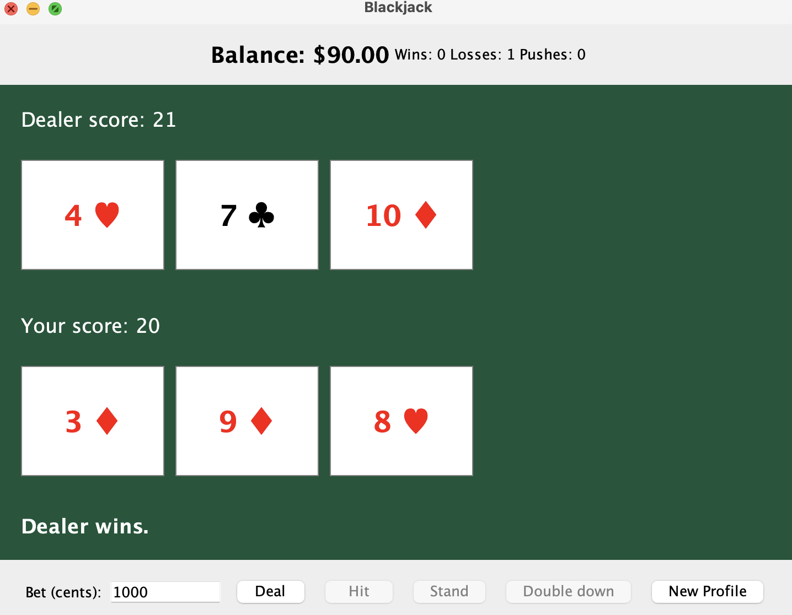

# Blackjack

A blackjack game built in Java. 

You can hit, stand, double down, and play multiple rounds. The dealer draws one card at a time, and your balance and win/loss/push stats are saved between sessions.

## Running it

You need Java 21 or newer and Maven. From the project folder, run:
mvn clean package
java -jar target/blackjack-1.0-SNAPSHOT.jar

To use the command-line version instead:
java -cp target/classes blackjack.BlackjackApp

## Playing

You start with $100 in simulated money. Enter bets in cents, so 1000 is a $10 bet. Bets have to be positive, even amounts within your balance. Using even cents keeps the blackjack payout exact.

- Blackjack pays 3:2. Regular wins pay 1:1, and ties return your bet.
- Aces automatically count as 1 or 11.
- The dealer stands on 17, including soft 17.
- You can double down on your first two cards if you have enough money. You get one more card and your turn ends.
- Splitting, insurance, and surrender are not included.

Finish the round before closing the window. Your balance and stats are saved to `player.properties` in the folder you launch from. The New Profile button resets both after confirmation.

For the CLI, use `h`, `s`, and `d` for actions, or `q` at the bet prompt to save and quit.

## Tests
mvn test

The JUnit tests cover ace scoring, blackjack, payouts, balance validation, double down, and dealer turns. Prepared decks let the tests check specific hands without relying on random cards.

## Code structure

`BlackjackGame` handles rounds and payouts. `Card`, `Deck`, and `Hand` handle the cards and scoring. `Player` and `PlayerStats` track money and results, while `PlayerSave` reads and writes the save file.

The Swing GUI and CLI use the same game logic. The GUI uses a Swing timer to pause between dealer draws without freezing the window.

Earlier versions and manual checks are kept in [learning](learning/README.md).
